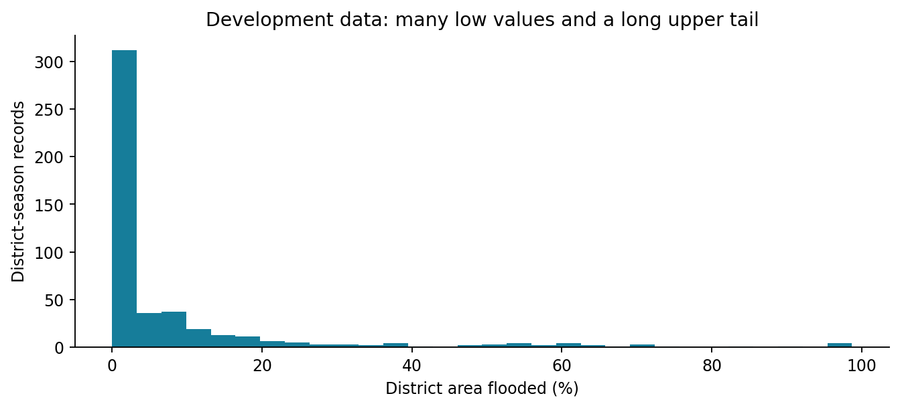
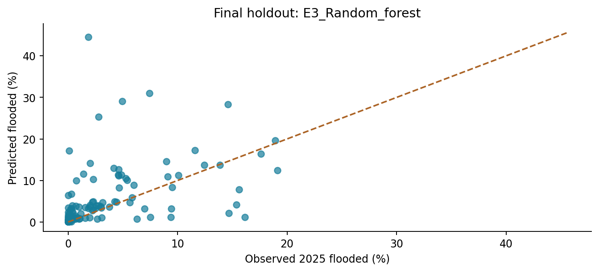

# FloodGuard AI

Next-season district flood-exposure estimation across Pakistan

M.Sohail (16032)  |  M.Umar (16031)

City University of Science & Information Technology (CUSIT)
Programming for Artificial Intelligence | Fall 2026
Course coordinator: Syed Muhammad Mohuddin
Prepared: 24 November 2026

Executive summary

FloodGuard AI evaluates a small, transparent regression workflow for estimating the percentage of a district that will be detected as flooded in the next monsoon season. The proposed users are district preparedness analysts who need evidence about whether historical exposure can support preliminary research. No stakeholder consultation or institutional adoption is claimed.

The real source dataset contains 640 district-season records: 160 districts observed in 2022–2025. An exact previous-year join produces 480 supervised examples. The model uses prior-season flooded percentage, district area and province, while excluding current-season flood measurements and derived spatial statistics. Three experiments compare two Ridge configurations with a Random Forest.

Training targets are from 2023 and model selection uses 2024. After configuration selection, the model is refitted on 2023–2024 and evaluated on the untouched 2025 target period. The selected forest obtains MAE 2.726 percentage points, RMSE 6.016 and R² -0.978. Persistence obtains MAE 4.388, while the training-median benchmark obtains a better MAE of 2.474.

The central finding is therefore a limitation: prior exposure and coarse geography do not establish dependable next-season predictive value. This package supplies a reproducible baseline, honest error analysis, executable demonstration and evidence for further research. It must not guide evacuation, compensation or operational resource allocation.

The report has ten body pages, followed by references. Detailed dictionaries, raw/clean data, metrics, tests, contribution plan and execution evidence accompany it. Git hosting is omitted at the user’s request; course compliance gaps are recorded separately.

# 2. Problem, stakeholder and objectives

Pakistan’s floods create a clear public-service problem. The 2022 post-disaster assessment reported damages and economic losses exceeding USD 30 billion [2]. This establishes the value of better preparedness, but does not imply that a small classroom model can supply safe operational advice.

The proposed stakeholder is a district-level disaster-preparedness analyst. The analytical question is: for a district already present in the historical dataset, how accurately can the next season’s detected flooded percentage be estimated using information from the preceding season and static district metadata? The unit of prediction is a district-season, not a household, person or individual storm.

The target is pct_flooded in target year t. Inputs are pct_flooded in t-1, area_km2 and province_name. This deliberately modest scope avoids inventing rainfall, river-flow, elevation or socioeconomic observations that the supplied data do not contain. It is a retrospective one-season-ahead evaluation, not an hourly or daily forecast.

| Criterion fixed before fitting | Evaluation rule | Observed outcome |
| --- | --- | --- |
| C1: typical absolute error | 2025 MAE ≤ 5 percentage points | 2.726; met |
| C2: beat a simple historical rule | At least 10% lower 2025 MAE than persistence | 37.9% lower; met |
| Additional diagnostic | Compare a training-median model and R² | Median is better; R² is negative |

The criteria are educational design targets selected before the experiments. They were not set by a disaster-management authority. Their fulfilment is insufficient for deployment: the additional benchmark exposes a weakness that the first two criteria miss. A future acceptance test should require robust improvement across several unseen seasons and meaningful regional performance.

The intended output is a reproducible table of estimates and errors that an analyst can inspect. It does not measure deaths, displacement, damage, crop loss or the probability that flooding will occur. Flood exposure and social vulnerability are different concepts. A low predicted percentage cannot establish that a district is safe.

Problem approval is not evidenced. Flood preparedness fits the broad public-services motivation, but the final problem statement and the two-member team arrangement still need the course coordinator’s resolution.

# 3. Background, related sources and dataset choice

The selected Zenodo record provides annual exposure summaries and spatial statistics [1]. Its district table directly matches a district-level analytical question. The project uses these observations to test next-season prediction; the source itself should not be interpreted as an operational forecasting model.

The World Bank assessment [2] motivates preparedness through documented disaster impacts. FAO’s crop and flood products [3] show an alternative use of spatial observations for agricultural impact assessment. Those products could support later validation or additional features, but their imagery and crop labels are not part of the implemented training data.

FloodTraces [4] describes complementary displacement, mobility and climate material. Its record is restricted, and combining such sources would require appropriate access and reconciliation of administrative codes. No restricted files are redistributed. scikit-learn’s guidance on leakage and metric selection [5,6] informs the evaluation design and the interpretation of regression error.

| Candidate | Observed size / time | Decision |
| --- | --- | --- |
| District table [1] | 640 rows; 13 columns; 160 units; 2022–2025 | Selected: direct stakeholder fit and manageable audit |
| Tehsil table [1] | 2,308 rows; 11 columns; 577 units; 2022–2025 | Compared and bundled; finer scale but no extra seasons |
| FloodTraces [4] | Multiple data types; restricted record | Contextual alternative only; no model use |

The two downloaded tabular candidates have no missing cells or duplicate unit-year keys. They are related products from the same publisher, not independent validation datasets. More tehsil rows would not fix the principal weakness: only four seasons are available. Finer spatial units also increase alignment work and do not justify a random split across correlated locations.

The gap addressed is a small reproducible test of temporal transfer. The design asks whether earlier exposure plus simple geography predicts a later season better than basic alternatives. It does not claim a new satellite algorithm or a validated hydrological model. The outcome is useful even when the proposed model fails to outperform a constant benchmark.

# 4. Dataset audit, dictionary and preparation

The source is attributed to Abdullah Umer, Zenodo version 1, DOI 10.5281/zenodo.20100773, under CC BY 4.0 [1]. The district CSV supplied by the user exactly matches the publisher’s MD5. The tehsil CSV and original dictionary were downloaded on 24 November 2026 and also match published checksums. Raw bytes remain unchanged; provenance records include SHA-256 hashes.

| Audit item | Finding |
| --- | --- |
| Rows / columns / unique districts | 640 / 13 / 160 |
| Season coverage | 160 observations in each of 2022, 2023, 2024, 2025 |
| Missing cells / duplicate rows / duplicate keys | 0 / 0 / 0 |
| Zero target values | 104 district-season observations |
| Categorical groups | Seven province/territory labels; metadata stable per district |
| Supervised rows | 480 after exact preceding-year join |

district_code is the joining key; district_name is a reporting label; province_name is categorical. area_km2 describes district area. flooded_km2 and pct_flooded describe the observed season. year establishes temporal order. gi_z, hotspot, lisa_quad, lisa_p, z_val and z_lag describe spatial statistics derived from the seasonal exposure. The full dictionary is included separately [7].

The pipeline strips identifier whitespace, converts core numeric fields, checks finite values and positive areas, rejects duplicate district-year keys, and verifies the capped area-ratio formula. It sorts rows without dropping legitimate extreme observations. Missing targets are rejected rather than imputed. Because the current source is complete, training imputation serves only as a pipeline safeguard and does not modify any observed target.

A zero denotes no detected flood extent in the source, not guaranteed absence of flooding. The publisher documents detection limitations; the project has no independent ground-truth validation. Boundary coverage reflects this source’s 160-unit snapshot and should not be read as a claim about every current administrative unit. No personal records are present; team names identify authors, not training subjects.

# 5. Exploratory analysis and feature decisions

Exploratory plots use only 2022–2024. The 2025 holdout is reserved for final diagnostics. This boundary prevents later-season observations from shaping feature or model decisions. The source audit still checks the complete file’s schema and integrity; this does not fit preprocessing parameters or choose a model.

This skew motivates a robustly interpretable primary metric, MAE, and a median predictor. RMSE is retained because a few large mistakes can matter greatly. No target threshold is invented to turn the problem into classification, and no classification accuracy or confusion matrix is therefore appropriate.

| Additional EDA figure | Interpretation and consequence |
| --- | --- |
| 02_year_comparison.png | Development means: 13.280% in 2022, 4.897% in 2023, 5.667% in 2024. Seasonal shifts motivate time ordering. |
| 03_province_exposure.png | Regional exposure differs. Province is tested as a feature; these are unweighted district means, not province-area flood rates. |
| 04_lag_relationship.png | Year-to-year relationships are imperfect and differ by target year. Compare persistence and a nonlinear alternative. |

All four full-size charts and individual explanations are available in the notebook and reports folder. Current-year flooded area and every current-year spatial statistic are excluded despite their apparent association with the target. That association would be unavailable before the season and would inflate reported predictive skill.

# 6. Methodology and chronological evaluation

An exact self-join links each district in target year t to that district’s observation in t-1. It is keyed by district_code and the shifted year, with one-to-one validation. The 160 first-year rows cannot be target examples because 2021 is absent. If a year is missing, the join does not silently substitute a more distant year.

| Stage | Targets used | Purpose |
| --- | --- | --- |
| Initial fit | 2023: 160 rows; lag comes from 2022 | Fit each candidate and training-only preprocessing |
| Validation | 2024: 160 rows; lag comes from 2023 | Choose configuration by MAE |
| Final refit | 2023–2024: 320 rows | Fit selected fixed configuration with more available history |
| Final test | 2025: 160 rows; lag comes from 2024 | Report held-out metrics; no retuning |

The same districts occur across splits intentionally: the intended task is forecasting later seasons for known districts. This does not establish generalisation to unseen districts or different administrative boundaries. Spatial correlation also means that 160 held-out rows are not necessarily 160 statistically independent observations.

Ridge uses alpha=10. E1 includes only the lag; E2 adds district area and one-hot province indicators. Numeric preprocessing contains median imputation and standard scaling. Categories use one-hot encoding with unseen values ignored. These steps are inside a scikit-learn Pipeline and ColumnTransformer, so each fit learns only from its training rows [5]. District codes and names are not predictive features.

The Random Forest uses 300 trees, maximum depth 6, minimum leaf size 5 and random seed 42. Its numeric scaling is retained for pipeline consistency, although trees do not require it. These settings constrain a small-data experiment; they are not a claim of optimal hyperparameters. Predictions are clipped to 0–100%, matching the physical target range.

MAE is the mean absolute difference between observed and predicted percentages. MSE averages squared differences, RMSE is its square root, and R² compares squared error to variation around the test mean [6]. MAE and RMSE are in percentage points; MSE is in squared percentage points. A negative R² is allowed and is an important failure signal.

# 7. Implementation and reliability

The project separates source data, processed data, reusable implementation, notebook explanation, model artefacts, tests and reporting. load_data and validate_data audit the input. make_supervised constructs the exact lag. make_model builds preprocessing and the estimator. predict_checked validates demo inputs and bounds the output. run executes the fixed experiment protocol and writes the evidence files.

The notebook provides a guided execution of the modular code rather than a disconnected copy of the model. It displays the source audit, candidate dataset comparison, split counts, validation and final metrics, six charts, regional errors, test results and a working demonstration. All nine code cells executed successfully through IPython in-process. Standard Jupyter kernel launch was blocked by environment socket restrictions, so frontend launch remains unverified here.

| Reliability group | Verified cases |
| --- | --- |
| Input integrity | Missing columns/file; duplicate keys; empty dataset; zero area; out-of-range percentage; NaN target |
| Time and leakage | Exact lag values; missing-year gap not bridged; changing final-year labels leaves that year’s features unchanged |
| Prediction interface | Unseen province handled; invalid lag rejected |
| Reproducible artefacts | Publisher checksums; deterministic model seed; executed notebook; saved CSV metrics and model |

Twelve automated tests pass. These tests validate program behaviour, not forecast usefulness. Deliberately invalid test fixtures are separate from the real modelling data. The raw dictionary initially failed UTF-8 decoding because its source uses Windows-1252; the read path was corrected to cp1252 without altering the original bytes.

The command-line demo retrieves a real district’s 2024 features, predicts its 2025 flooded percentage and displays the observed value. Unknown districts and unsupported target years receive clear errors. The saved model is restricted to this holdout demonstration; it has not been refitted into a 2026 deployment model.

Git hosting is omitted as requested. The course’s collaboration requirement is therefore unfulfilled. Suggested responsibilities, real preparation activities and an empty meeting template are supplied, but no commits or student contributions are invented. The AI-assistance statement identifies how this package was prepared. Both students must be able to explain the entire workflow.

# 8. Experiments and results

The experiment sequence tests a feature change and then a model change. E1 establishes a supervised linear baseline. E2 asks whether area and province help the same linear model. E3 uses the same expanded feature set with a nonlinear estimator. The winner is selected using only the 2024 validation MAE; the selection record is written before final-test scoring.

| Experiment | Val. MAE | Val. RMSE | Val. R² |
| --- | --- | --- | --- |
| E1_Ridge_lag | 4.020 | 9.105 | 0.401 |
| E2_Ridge_geography | 4.096 | 9.195 | 0.389 |
| E3_Random_forest | 4.006 | 9.560 | 0.339 |

The forest has the lowest validation MAE, about 4.006, only 0.014 points below lag-only Ridge. This tiny difference is not evidence of statistically significant superiority. The forest also has worse validation RMSE, illustrating that a single average loss can favour a different error profile. The predetermined selection rule is retained.

| Final 2025 model | MAE | MSE | RMSE | R² |
| --- | --- | --- | --- | --- |
| E1_Ridge_lag | 2.804 | 28.696 | 5.357 | -0.569 |
| E2_Ridge_geography | 2.872 | 30.215 | 5.497 | -0.652 |
| E3_Random_forest | 2.726 | 36.193 | 6.016 | -0.978 |
| B0_Training_median | 2.474 | 21.570 | 4.644 | -0.179 |
| B1_Persistence | 4.388 | 121.970 | 11.044 | -5.667 |

Every learned comparison model is refitted on 2023–2024 before final evaluation. The median benchmark learns only the training-target median, approximately 0.669%. Persistence simply carries the previous season’s observation forward. The final test table is a diagnostic comparison, not a second model-selection stage.

The selected model meets both educational criteria: MAE is below 5 and is 37.9% lower than persistence. However, the constant training-median benchmark achieves better MAE and RMSE. The forest’s negative R² means its squared error exceeds that of the test-mean reference used by the metric. That reference is not itself a trained forecasting method.

The appropriate conclusion is that the experiment is reproducible but the forecasting claim is not supported strongly enough. A different test winner must not simply replace the preselected model and be presented as independently validated. Further model changes require a new evaluation period or a properly nested temporal design.

# 9. Error analysis, bias and limitations

The largest error is Jacobabad: observed 1.843%, predicted 44.529%, an absolute difference of 42.686 percentage points. Shikarpur, Larkana and Sohbatpur also receive substantial overpredictions. Pakpattan illustrates the opposite failure: observed 16.149% but predicted about 1.138%. These examples are genuine held-out records, not hypothetical cases.

| Province / territory | Districts | MAE (points) |
| --- | --- | --- |
| Azad Kashmir | 10 | 0.571 |
| Balochistan | 35 | 1.842 |
| Gilgit Baltistan | 14 | 0.666 |
| Islamabad | 1 | 1.249 |
| Khyber Pakhtunkhwa | 35 | 0.723 |
| Punjab | 36 | 3.760 |
| Sindh | 29 | 6.716 |

Sindh has the highest average error, while a single observation represents Islamabad. These small and uneven group sizes prevent a confident fairness claim. District averages also conceal within-district exposure and vulnerability. Region names are geographic categories, not proxies that establish household risk.

The 2025 unweighted mean exposure is 2.479%, below all development seasons. Only one independent final season is available, so temporal uncertainty is substantial. The data lack pre-season rainfall, river conditions and verified ground observations. Sensor coverage, coarse aggregation, shifting flood regimes and correlated districts limit transfer. The model provides no calibrated predictive intervals.

# 10. Recommendation, conclusion and next steps

For the proposed preparedness analyst, the defensible recommendation is to use this package as an auditable research baseline and a way to identify data needs. It should not automate decisions. A model that beats persistence yet loses to a constant baseline has not established reliable added value, even when its average MAE seems small.

The implementation achieves the technical learning goals: public data acquisition with attribution, audit and dictionary, pandas/NumPy preparation, four explained EDA figures, two supervised estimator families, three experiments, chronological evaluation, regression metrics, reusable code, edge-case tests and reproducible outputs. Its evidence supports a critical conclusion rather than an optimistic deployment claim.

Future work should first extend the number of seasons and independently verify the target observations. Add predictors genuinely available before the forecast date, such as appropriately lagged rainfall or river measures, with documented timestamps and spatial matching. Do not join post-event observations and then label the resulting model as an early-warning system.

With more seasons, use rolling temporal evaluation and retain a final untouched period. Compare linear, nonlinear and simple constant/persistence baselines in each fold. Test unseen districts separately if geographic transfer becomes an objective. Consider target transformations, alternative losses or calibration only within development data; evaluate large misses and regional errors alongside aggregate MAE.

Before any real decision support, obtain stakeholder-defined tolerances, an independent validation dataset, coverage checks, uncertainty reporting and a human review process. This dataset measures detected flood extent, not social vulnerability or losses. Any population or mobility enrichment would need its own access conditions, privacy review and verified geographic alignment.

| Team member | Proposed review / presentation focus | Evidence status |
| --- | --- | --- |
| M.Sohail — 16032 | Problem, data audit, features and EDA | Student review and actual contributions pending |
| M.Umar — 16031 | Models, evaluation, tests and demo | Student review and actual contributions pending |

Both students must review all code and defend the full method. No claim is made that a semester of collaboration has occurred. The course requires 3–4 members, documented approval and Git evidence; the two-member arrangement and omitted repository remain outstanding submission matters. The contribution matrix, task log and viva guide are supplied to support genuine follow-through.

# References

1. Umer, A. (2026). A Multi-Resolution Geospatial Dataset of Monsoon Flood Extent and Spatial Clustering for Pakistan (2022–2025), version 1. Zenodo. https://doi.org/10.5281/zenodo.20100773. Primary dataset; district and tehsil tables; CC BY 4.0. Supports the four-season exposure task, while providing only limited temporal history.

2. World Bank (2022, October 28). Pakistan: Flood Damages and Economic Losses Over USD 30 billion and Reconstruction Needs Over USD 16 billion – New Assessment. https://www.worldbank.org/en/news/press-release/2022/10/28/pakistan-flood-damages-and-economic-losses-over-usd-30-billion-and-reconstruction-needs-over-usd-16-billion-new-assessme. Establishes the disaster-preparedness context; it does not validate this model or provide its training labels.

3. FAO (2025, December 29). New crop type and flood extent data for Pakistan. https://www.fao.org/agroinformatics/training-and-resources/data-sets/data-set-detail/new-crop-type-and-flood-extent-data-for-pakistan/en. Describes high-resolution crop and inundation products for KP, Punjab and Sindh; useful future independent validation or enrichment, not used in the implemented model.

4. Pietrostefani, E., Pardy, M., Mason, M., Nasuto, A., & Rowe, F. (2026). FloodTraces Hackathon Datasets, version 2. Zenodo. https://zenodo.org/records/20828435. Contextual population, displacement and climate sources. The record is restricted; no restricted files were downloaded or redistributed. Geographic alignment and access permissions would need separate work.

5. scikit-learn developers. Common pitfalls and recommended practices. https://scikit-learn.org/stable/common_pitfalls.html. Supports training-only preprocessing, pipelines and separation of training from evaluation. Documentation accessed online may describe a newer release than the pinned implementation (1.8.0).

6. scikit-learn developers. Metrics and scoring: quantifying the quality of predictions. https://scikit-learn.org/stable/modules/model_evaluation.html. Supports the choice and interpretation of MAE, MSE, RMSE and R². MAE in this project is measured in percentage points, not classification accuracy.

7. Umer, A. (2026). Variable_Dictionary.csv, accompanying [1]. https://zenodo.org/records/20100773/files/Variable_Dictionary.csv. Defines area and flood percentages, spatial statistics and detection limitations. Original file is bundled and should be read as Windows-1252.

Supporting artefacts: docs/ contains the complete project dictionary, contribution plan, task/reliability record, submission checklist and viva guide. evidence/ contains test output, demo output, checksums and the model-selection record.
